# Inteligência de Clientes e Estratégia Comercial no Setor de Delivery

**Análise de Dados | Marketing & CRM | Business Intelligence**


## 1. Resumo executivo

Atrair novos consumidores é apenas uma parte do crescimento comercial. Para definir estratégias de relacionamento eficientes, uma operação de delivery também precisa entender quem compra, quanto consome, como responde às campanhas e quais públicos merecem atenção prioritária.

Esta investigação parte de uma questão central: **como direcionar as ações de Marketing e CRM a partir das diferenças de comportamento observadas na base de consumidores?**

Foram analisados 2.021 registros tratados, abrangendo perfil familiar, renda, consumo acumulado em seis categorias, contagens de compras por canal e resposta a seis campanhas. A investigação combina qualidade de dados, estatística descritiva, análise exploratória e segmentação comportamental.

| Indicador | Resultado |
|---|---:|
| Registros analisados | 2.021 |
| Gastos acumulados nas seis categorias | 1.228.184 |
| Recência mediana da última compra | 49 dias |
| Resposta registrada à última campanha | 15,39% |

Três descobertas orientam as recomendações comerciais:

- **Concentração de consumo:** vinhos e carnes representam 77,76% dos gastos nas seis categorias.
- **Fidelização e reativação:** dois segmentos, que somam 49,78% da base, concentram 90,84% dos gastos em vinhos, carnes, peixes, frutas e doces. A recência distingue esses públicos.
- **Personalização:** a resposta à última campanha foi de 40,85% entre registros com aceitação anterior e 8,59% entre aqueles sem aceitação, uma razão de aproximadamente 4,76 vezes.

Os resultados sustentam uma proposta de segmentação e experimentação comercial, não uma previsão de retorno financeiro. As unidades monetárias não foram informadas na fonte.

## Sumário

- [1. Resumo executivo](#1-resumo-executivo)
- [2. Contexto e objetivos de negócio](#2-contexto-e-objetivos-de-negócio)
- [3. Antes de investigar o consumidor, conhecer os dados](#3-antes-de-investigar-o-consumidor-conhecer-os-dados)
- [4. O que realmente estamos medindo?](#4-o-que-realmente-estamos-medindo)
- [5. Onde está concentrado o consumo?](#5-onde-está-concentrado-o-consumo)
- [6. O que diferencia os perfis de consumo?](#6-o-que-diferencia-os-perfis-de-consumo)
- [7. De perfis de consumo a segmentos comerciais](#7-de-perfis-de-consumo-a-segmentos-comerciais)
- [8. Quem responde às campanhas?](#8-quem-responde-às-campanhas)
- [9. Canais e expansão do consumo](#9-canais-e-expansão-do-consumo)
- [10. Recomendações e experimentação](#10-recomendações-e-experimentação)
- [11. Arquitetura analítica e metodologia](#11-arquitetura-analítica-e-metodologia)
- [12. Próximos passos: da investigação à inteligência contínua](#12-próximos-passos-da-investigação-à-inteligência-contínua)
- [13. Reprodutibilidade](#13-reprodutibilidade)
- [14. Limitações e procedência dos dados](#14-limitações-e-procedência-dos-dados)

---

## 2. Contexto e objetivos de negócio

Uma campanha generalista pode tratar igualmente consumidores que apresentam necessidades muito diferentes. Um público que compra frequentemente pode demandar ações de relacionamento, enquanto outro, com histórico de consumo expressivo e menor atividade recente, pode justificar um teste de reativação.

Antes de propor investimentos, é necessário investigar onde essas diferenças aparecem e se os indicadores disponíveis permitem distingui-las.

| Pergunta de negócio | Finalidade |
|---|---|
| Os dados são consistentes? | Estabelecer confiança nas métricas |
| Onde se concentra o consumo? | Identificar categorias e públicos relevantes |
| Quais características se associam aos gastos? | Compreender diferenças de perfil |
| Quem apresenta maior resposta histórica? | Definir públicos para testes de CRM |
| Como distinguir fidelização de reativação? | Construir segmentação comportamental |
| Como medir os efeitos das recomendações? | Planejar experimentos controlados |

## 3. Antes de investigar o consumidor, conhecer os dados

A primeira etapa não foi construir gráficos, mas verificar se os registros poderiam sustentar conclusões confiáveis. O diagnóstico examinou dimensões, tipos, valores ausentes, duplicidade, variáveis constantes e consistência entre campos.

| Indicador de qualidade | Entrada | Após tratamento |
|---|---:|---:|
| Registros | 2.205 | 2.021 |
| Colunas | 44 | 31 |
| Duplicatas por conteúdo, após retirada do índice | 184 | 0 |

A remoção de 184 registros corresponde a 8,34% da entrada. Como não há identificador estável, a deduplicação por conteúdo é uma premissa de trabalho, que exigiria validação com o responsável pela fonte em produção.

Foram removidas dez colunas indicadoras redundantes de escolaridade e estado civil, duas constantes e uma coluna de índice. Três registros com valores negativos em `MntRegularProds` foram preservados, pois não há documentação suficiente para classificá-los como erros. Uma análise de sensibilidade permite avaliar a influência dessa decisão.

O tratamento prevê testes de ausência de nulos e duplicatas, consistência de `kids = Kidhome + Teenhome`, igualdade entre `expenses` e `MntTotal`, e persistência em Parquet com comparação após leitura.

[Diagnóstico da base](notebooks/01_data_profiling.ipynb) · [Tratamento e validações](notebooks/02_data_cleaning.ipynb)

## 4. O que realmente estamos medindo?

Uma descoberta importante surgiu na reconciliação dos indicadores financeiros. Embora `expenses` e `MntTotal` apresentem valores iguais, nenhuma das duas medidas representa a soma das seis categorias de consumo.

A comparação linha a linha confirmou que `expenses` é exatamente a soma de vinhos, carnes, peixes, frutas e doces em todos os 2.021 registros. A categoria `MntGoldProds` fica de fora.

| Medida | Total |
|---|---:|
| Gastos em cinco categorias (`expenses`) | 1.139.418 |
| Categoria adicional (`MntGoldProds`) | 88.766 |
| Gastos nas seis categorias (`spend_all`) | 1.228.184 |

A análise preserva a métrica original e utiliza uma segunda medida calculada quando o objetivo é avaliar o mix completo. Essa distinção é essencial: participações calculadas sobre universos diferentes não são diretamente comparáveis.

A renda representa renda familiar anual, enquanto as despesas por categoria correspondem aos últimos dois anos. Não se conhece a moeda ou a janela temporal das contagens de compras. Portanto, os gastos não devem ser interpretados como faturamento líquido, margem ou ticket médio.

## 5. Onde está concentrado o consumo?

### 5.1. Duas categorias dominam o mix

Somando os gastos de cada categoria e dividindo pelo total das seis, encontramos a seguinte distribuição:

| Categoria | Gastos acumulados | Participação |
|---|---:|---:|
| Vinhos | 619.421 | 50,43% |
| Carnes | 335.607 | 27,33% |
| Gold Products | 88.766 | 7,23% |
| Peixes | 75.997 | 6,19% |
| Doces | 55.110 | 4,49% |
| Frutas | 53.283 | 4,34% |

<p align="center">
  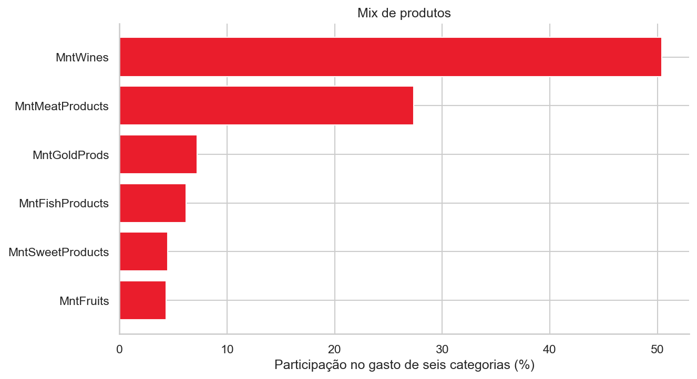
</p>

Vinhos e carnes, juntos, representam 77,76% dos gastos. A concentração sugere priorizar o entendimento da demanda dessas categorias e investigar a dependência comercial em relação a elas. Não permite concluir que tenham maior margem ou que devam receber mais orçamento sem informação de custos.

### 5.2. A regra de Pareto se confirma?

A investigação ordenou os registros do maior para o menor gasto e calculou sua participação acumulada. Os 405 registros superiores, aproximadamente 20% da base, concentram **53,67%** dos gastos nas cinco categorias. Ao incluir Gold Products, a proporção é de 52,30%, selecionando novamente os maiores gastos.

<p align="center">
  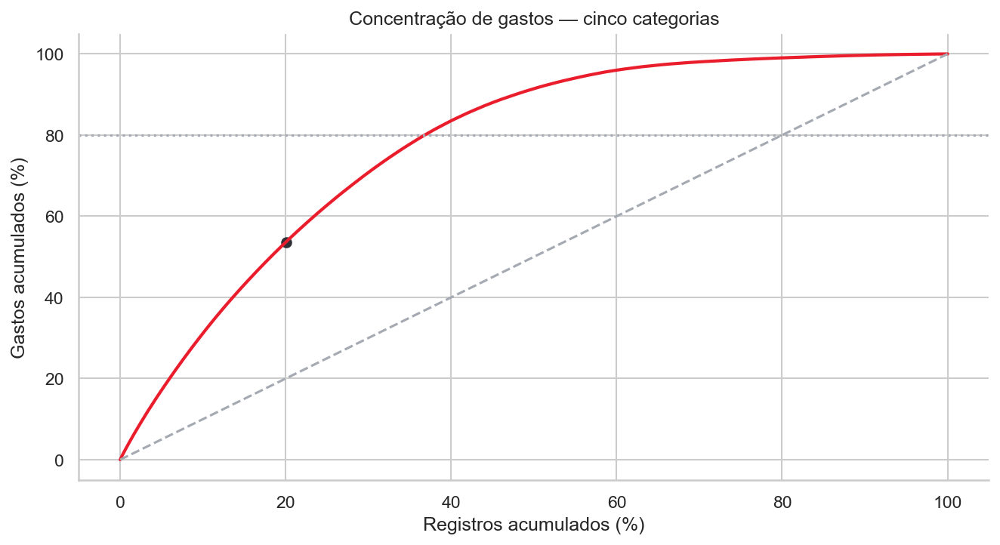
</p>

A regra clássica 80/20 não se confirma. Existe concentração relevante, mas o restante da base também representa uma parcela importante do consumo. A estratégia deve reconhecer os públicos de maior valor sem abandonar os demais.

## 6. O que diferencia os perfis de consumo?

### 6.1. Renda familiar e gastos

Para investigar a relação entre capacidade financeira e consumo, foram utilizados dois coeficientes de correlação complementares.

| Método | Resultado | Interpretação |
|---|---:|---|
| Pearson | 0,8192 | Forte associação linear positiva |
| Spearman | 0,8678 | Forte associação monotônica positiva |

<p align="center">
  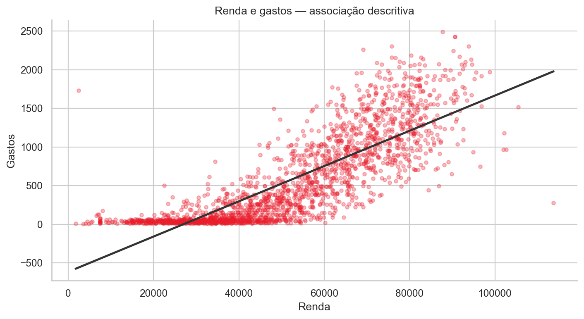
</p>

Públicos com renda familiar mais alta tendem a registrar maiores gastos. O coeficiente de Spearman, baseado na ordenação dos valores, reforça a associação sem exigir uma relação estritamente linear. O quadrado de Pearson, cerca de 67,11%, corresponde à proporção da variação explicada pelo ajuste linear simples com intercepto, na amostra — não a uma conclusão causal.

O gráfico também permite avaliar dispersão e possíveis desvios da linearidade. Renda, isoladamente, não é suficiente para estimar a demanda individual. Uma análise preditiva exigiria validação fora da amostra e investigação de outras variáveis.

### 6.2. Composição familiar e sensibilidade a descontos

A próxima pergunta foi se a presença de crianças e adolescentes no domicílio se associa a diferenças de consumo. A mediana foi escolhida para comparar grupos com menor influência de gastos extremos.

| Crianças e adolescentes no domicílio | Registros | Gasto mediano (cinco categorias) | Média de compras com desconto |
|---|---:|---:|---:|
| 0 | 567 | 1.114 | 1,13 |
| 1 | 1.027 | 265 | 2,48 |
| 2 | 382 | 84 | 3,56 |
| 3 | 45 | 62 | 3,44 |

<p align="center">
  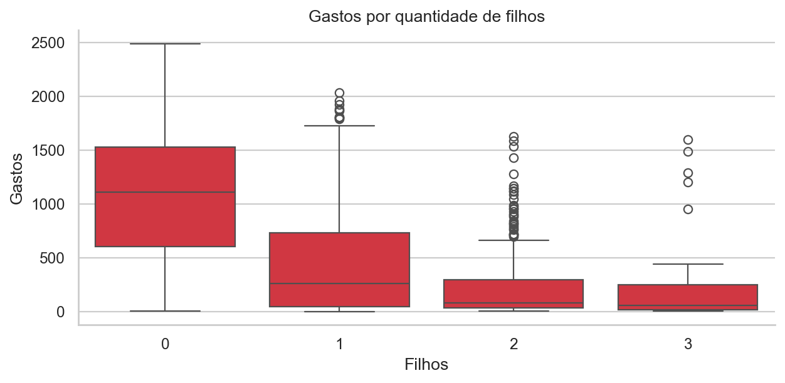
</p>

Os registros com crianças ou adolescentes apresentam medianas de gasto menores e contagens médias de compras com desconto superiores às do grupo sem filhos. Isso levanta uma hipótese comercial: diferentes perfis podem responder de forma distinta a propostas de economia, conveniência ou benefícios.

A contagem de compras com desconto não equivale à proporção de compras com desconto, nem comprova sensibilidade ao preço. É necessário verificar a janela das contagens e controlar diferenças de renda e frequência. O notebook 03 já inclui uma análise estratificada por quartis de renda como primeiro passo nessa direção.

Os valores de desconto nesta tabela são uma verificação complementar do CSV tratado, não uma nova seção implementada no notebook.

[Investigação estatística completa](notebooks/03_exploratory_analysis.ipynb)

## 7. De perfis de consumo a segmentos comerciais

### 7.1. Construção da segmentação RFM

A segmentação inspirada em RFM utiliza três características: recência (dias desde a última compra), frequência (aproximada pela soma das compras web, catálogo e loja) e valor monetário (gastos nas cinco categorias).

Os limites foram definidos a partir das medianas da própria base: 49 dias, 12 compras e 343 unidades monetárias, respectivamente. Recência menor ou igual a 49 dias é classificada como mais recente; frequência e valor iguais ou superiores aos respectivos cortes são classificados como altos.

<p align="center">
  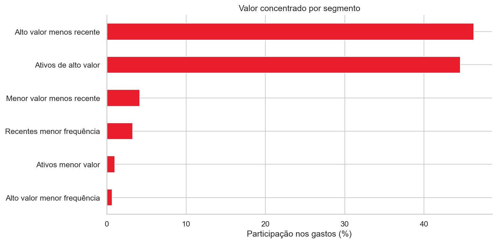
</p>

| Segmento | Registros | Participação nos gastos |
|---|---:|---:|
| Alto valor menos recente | 510 | 46,25% |
| Ativos de alto valor | 496 | 44,59% |
| Menor valor menos recente | 491 | 4,18% |
| Recentes menor frequência | 478 | 3,27% |
| Ativos menor valor | 39 | 1,04% |
| Alto valor menor frequência | 7 | 0,68% |

### 7.2. Mesmo valor, diferentes necessidades de relacionamento

Juntos, os dois primeiros segmentos representam 1.006 registros (49,78% da base) e 90,84% dos gastos em vinhos, carnes, peixes, frutas e doces.

| Indicador | Ativos de alto valor | Alto valor menos recente |
|---|---:|---:|
| Registros | 496 | 510 |
| Recência mediana | 24,5 dias | 73 dias |
| Gasto mediano | 964 | 960,50 |
| Gastos acumulados | 508.087 | 526.971 |
| Resposta à última campanha | 27,62% | 14,51% |

Apesar do consumo histórico semelhante, o tempo desde a última compra diferencia os grupos. O primeiro sugere uma frente de fidelização; o segundo, uma investigação de reativação. O intervalo de 73 dias não define abandono: seria necessário conhecer a frequência habitual de cada consumidor e acompanhar eventos posteriores.

A segmentação também é sensível aos cortes: substituir a mediana monetária pelo percentil 60 altera a classificação de alto valor de 204 registros. Por isso, os segmentos devem ser validados antes de virar regras permanentes de CRM.

## 8. Quem responde às campanhas?

### 8.1. Desempenho registrado

A avaliação das seis campanhas utiliza a proporção de registros com indicador positivo. Como não há informação de exposição ou entrega das mensagens, o denominador é a base de 2.021 registros, não uma audiência confirmada.

| Campanha | Aceitações | Proporção | IC de Wilson (95%) |
|---|---:|---:|---:|
| 01 | 133 | 6,58% | 5,58–7,75% |
| 02 | 26 | 1,29% | 0,88–1,88% |
| 03 | 151 | 7,47% | 6,40–8,70% |
| 04 | 155 | 7,67% | 6,59–8,91% |
| 05 | 146 | 7,22% | 6,17–8,44% |
| Última | 311 | 15,39% | 13,88–17,03% |

<p align="center">
  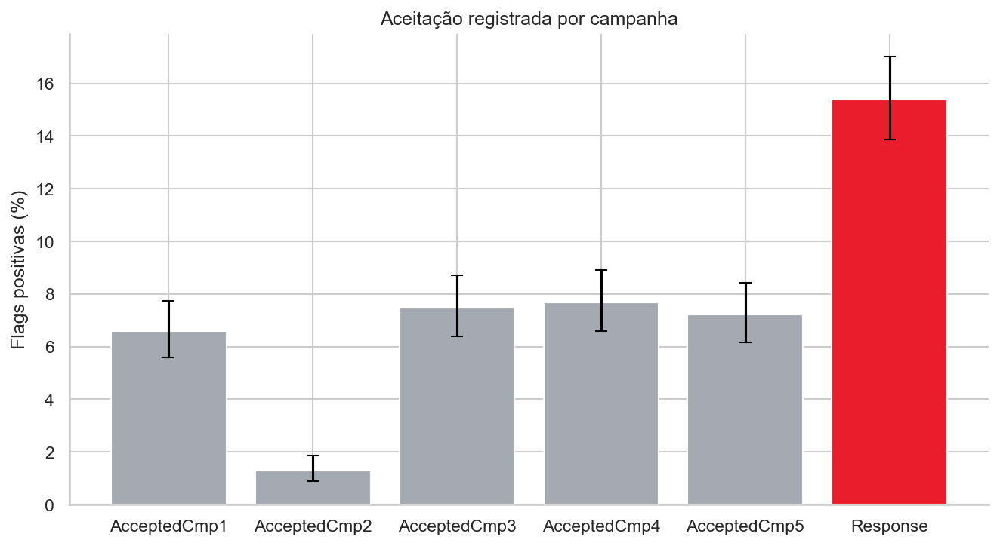
</p>

A campanha 02 apresenta a menor proporção registrada. A última tem a maior. A diferença levanta questões sobre oferta, canal, elegibilidade e comunicação, mas não permite identificar qual fator produziu o resultado. Os intervalos são estimativas descritivas sob hipóteses binomiais, não uma demonstração de superioridade causal entre campanhas.

### 8.2. O histórico como sinal de relacionamento

Ao separar os registros pela aceitação de pelo menos uma das cinco campanhas anteriores, surge uma diferença de 32,26 pontos percentuais na resposta à última campanha.

<p align="center">
  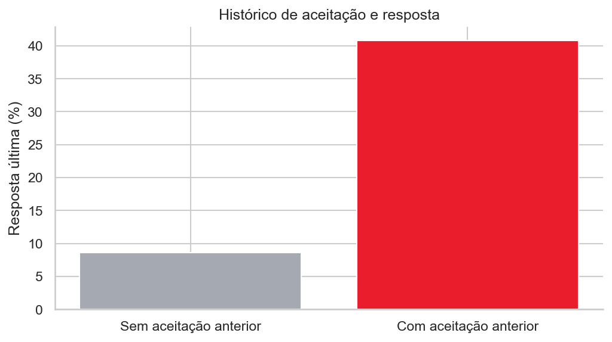
</p>

| Aceitações anteriores | Registros | Respostas positivas | Proporção |
|---|---:|---:|---:|
| Nenhuma | 1.595 | 137 | 8,59% |
| Uma | 301 | 94 | 31,23% |
| Duas | 75 | 39 | 52,00% |
| Três | 40 | 32 | 80,00% |
| Quatro | 10 | 9 | 90,00% |

O grupo com qualquer aceitação anterior reúne 426 registros e 174 respostas positivas (40,85%). Entre os 50 registros com três ou mais aceitações, 41 responderam (82%). A progressão é interessante, mas os últimos grupos são pequenos e exigem cautela. O detalhamento por contagem foi calculado adicionalmente sobre a base reconstruída.

O histórico é um candidato promissor para personalização. Antes de utilizá-lo como variável de um modelo, é necessário garantir que as aceitações anteriores estavam disponíveis antes da campanha alvo, evitando vazamento de informação (*data leakage*). Também seria necessário comparar formalmente seu desempenho com outras variáveis.

## 9. Canais e expansão do consumo

A soma das contagens de compras registra 46,21% em loja, 32,75% na web e 21,04% em catálogo. Esses são os canais originais da base; não representam modalidades de entrega nem participação de mercado de uma plataforma.

<p align="center">
  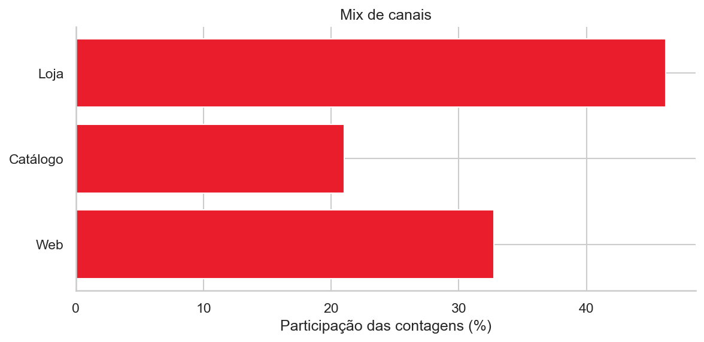
</p>

Para investigar venda cruzada, foi calculado o lift de coexistência de consumo: a frequência conjunta de duas categorias dividida pelo produto de suas frequências individuais. Lift acima de 1 indica coexistência superior à esperada sob independência.

<p align="center">
  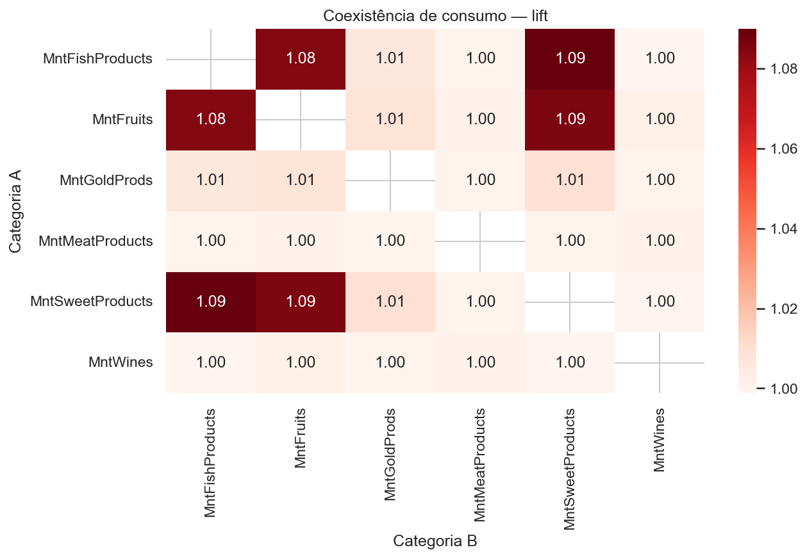
</p>

Peixes e doces apresentam lift de aproximadamente 1,090. Há 190 registros com consumo de peixes e sem gasto em doces. Esse público representa uma hipótese de teste, não demanda garantida. A associação é modesta, e a base não permite saber se os produtos foram comprados juntos no mesmo pedido.

## 10. Recomendações e experimentação

| Prioridade | Público ou problema | Ação proposta | Métrica a acompanhar |
|---|---|---|---|
| P1 | Ativos de alto valor | Testar benefícios de relacionamento | Compra incremental por elegível |
| P2 | Alto valor menos recente | Testar comunicação de retorno | Reativação incremental |
| P3 | Histórico de aceitação | Testar personalização de comunicação | Resposta incremental e descadastro |
| P4 | Categorias complementares | Testar ofertas de venda cruzada | Margem incremental e canibalização |
| Investigação | Campanha 02 | Levantar oferta, audiência e exposição | Desempenho por destinatário elegível |

A recomendação é começar com experimentação controlada, e não simplesmente aumentar o volume de ofertas. Um teste A/B randomizado deve comparar tratamento e controle, estabelecer uma janela de observação e acompanhar custos, margem, reclamações e descadastros.

O notebook 04 dimensiona um cenário ilustrativo de aumento de 15% para 18% na proporção de resposta, com significância bilateral de 5% e poder de 80%. O cálculo estima 2.402 participantes por braço (4.804 no total). A base disponível é insuficiente para esse desenho específico; será preciso ampliar o público ou revisar o efeito mínimo detectável. Nenhum experimento foi executado.

[Análise de negócio e recomendações](notebooks/04_business_analysis.ipynb)

## 11. Arquitetura analítica e metodologia

A separação entre diagnóstico, tratamento, exploração e avaliação de negócio favorece rastreabilidade e reprodutibilidade. Os notebooks de análise consomem independentemente o Parquet preparado na etapa de limpeza.

<p align="center">
  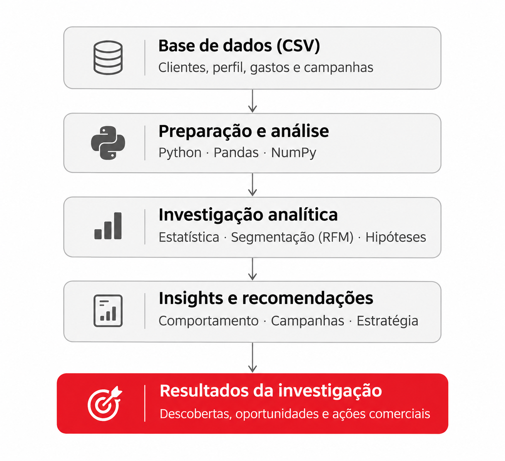
</p>

| Notebook | Métodos e entregas |
|---|---|
| [01 — Data Profiling](notebooks/01_data_profiling.ipynb) | Diagnóstico de qualidade e relatório CSV |
| [02 — Data Cleaning](notebooks/02_data_cleaning.ipynb) | Tratamento, reconciliação, testes e persistência |
| [03 — Exploratory Data Analysis](notebooks/03_exploratory_analysis.ipynb) | Distribuições, quartis, IQR, correlações, estratificação e sensibilidade |
| [04 — Business Analysis](notebooks/04_business_analysis.ipynb) | KPIs, Pareto, RFM, Wilson, lift e planejamento A/B |

## 12. Próximos passos: da investigação à inteligência contínua

O próximo estágio seria transformar uma análise pontual em uma capacidade recorrente de inteligência comercial. A evolução depende da disponibilização de fontes transacionais, identificadores estáveis e eventos com datas, além de regras de acesso e proteção de dados pessoais.

<p align="center">
  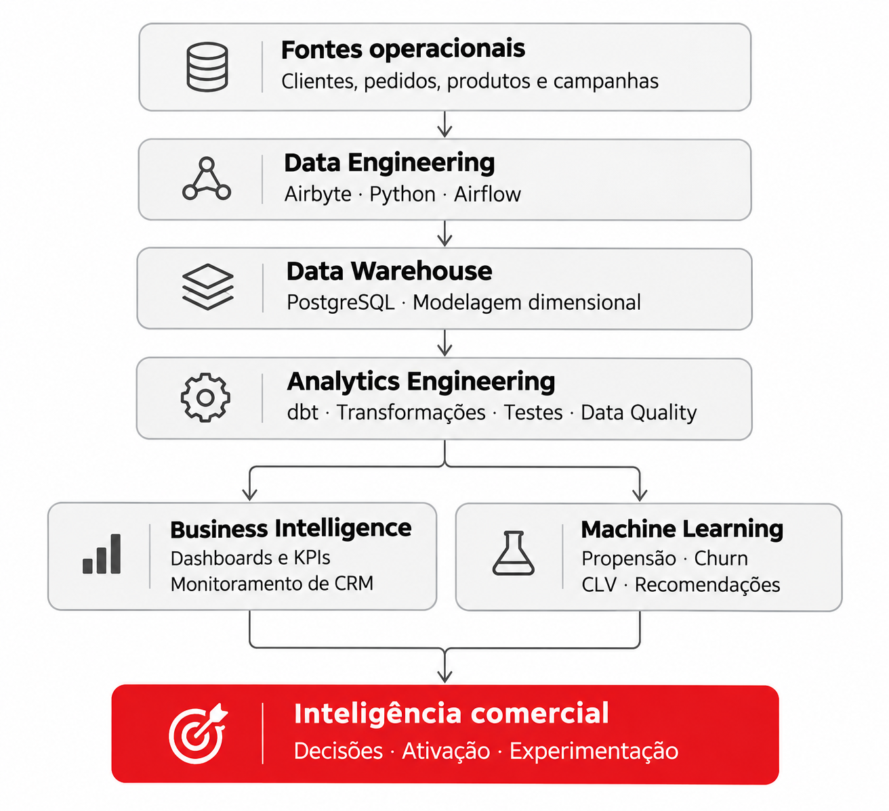
</p>

**Arquitetura proposta, ainda não implementada.** A escolha das ferramentas depende de volume, infraestrutura e requisitos da operação. Airflow pode orquestrar dependências e monitorar execuções quando houver necessidade operacional.

| Frente | Evolução proposta | Requisito principal |
|---|---|---|
| Engenharia de dados | Ingestão incremental e monitoramento | Fontes acessíveis e chaves estáveis |
| Data Warehouse | Fatos de pedidos, itens e eventos de campanhas; dimensões de clientes, produtos e tempo | Grão definido e histórico transacional |
| Analytics Engineering | Modelos dbt, testes de unicidade, integridade e métricas padronizadas | Contratos e dicionário de dados |
| BI | Painéis de consumo, retenção e desempenho de CRM | Métricas homologadas |
| Propensão à resposta | Baseline de regressão logística e comparação com outros modelos | Histórico anterior ao alvo, separação temporal, avaliação de precisão, recall, PR-AUC e calibração |
| Churn | Estimar risco de abandono | Definição temporal de inatividade e acompanhamento posterior |
| Customer Lifetime Value | Estimar valor futuro | Histórico por cliente, custos e margens |
| Recomendação | Investigar afinidade entre itens e personalizar ofertas | Dados de itens por pedido e testes online |

O objetivo não é empilhar tecnologias, mas escolher a menor arquitetura capaz de sustentar decisões confiáveis. O modelo de propensão, por exemplo, só deve orientar campanhas após validação temporal e avaliação de impacto incremental. Prever quem responde não equivale a prever quem responderá por causa da campanha.

## 13. Reprodutibilidade

```text
.
├── data/
│   ├── raw/
│   │   └── mkt_data.csv
│   └── processed/
│       └── mkt_data_clean.parquet
├── notebooks/
│   ├── 01_data_profiling.ipynb
│   ├── 02_data_cleaning.ipynb
│   ├── 03_exploratory_analysis.ipynb
│   └── 04_business_analysis.ipynb
├── reports/
│   └── figures/
│       ├── architecture/
│       │   ├── Fluxo_de_Arquitetura_Analitica.png
│       │   └── Arquitetura_de_Inteligencia_Continua.png
│       └── business/
├── requirements.txt
├── .gitignore
└── README.md
```

### Configuração do ambiente

Na raiz do repositório, crie um ambiente virtual Python:

```bash
python -m venv .venv
```

Após ativar o ambiente virtual, instale as dependências do projeto:

```bash
pip install -r requirements.txt
```

Inicie o ambiente de análise:

```bash
jupyter notebook
```

Disponibilizei o CSV autorizado em `data/raw/mkt_data.csv`. Execute os notebooks 01 e 02 com diretório de trabalho `notebooks/`, confirme a geração e releitura do Parquet e execute os notebooks 03 e 04. Os relatórios e imagens são gerados em `reports/`. Os gráficos deste README dependem da publicação desses arquivos nos caminhos indicados.

## 14. Limitações e procedência dos dados

Esta é uma investigação descritiva e observacional. Não há dados individuais de pedidos, margem, custo de campanhas, exposição confirmada, identificadores estáveis ou indicadores logísticos. A frequência é uma aproximação e os cortes RFM são dependentes da distribuição da amostra. Os resultados não demonstram causalidade, retorno incremental ou desempenho futuro.

Os resultados do notebook 04 foram obtidos sobre a reconstrução do CSV segundo as regras de limpeza; a execução integral sobre o Parquet local permanece uma validação necessária. As tabelas complementares de desconto e contagem de aceitações foram recalculadas diretamente do CSV deduplicado.

A base utilizada é proveniente de um desafio de Marketing associado ao iFood. A investigação emprega esse conjunto como referência para a contextualização comercial no setor de delivery, preservando as categorias e os canais originais. Os resultados não representam indicadores operacionais verificados do iFood nem de outra empresa específica. As recomendações e a arquitetura de evolução são propostas, não implementações em produção.
